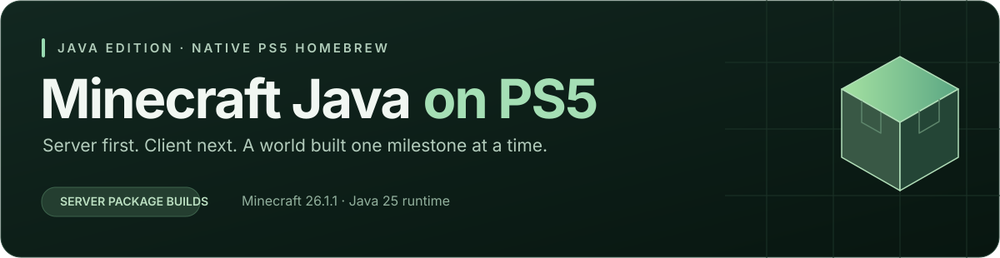

  

  <a href="#the-goal">The goal</a> ·
  <a href="#runtime-foundation">Java runtime</a> ·
  <a href="#roadmap">Roadmap</a> ·
  <a href="#follow-the-project">Follow the project</a>

# Minecraft Java on PS5

A homebrew project exploring **Minecraft Java Edition on PlayStation 5** — starting with a dedicated server, then working toward the client, controller support and mod compatibility.

> **Status: first PS5 server package builds.** The native title embeds the Java 25 runtime and targets Mojang's official 26.1.1 server JAR. Minecraft has not yet been launched on a console.

## The goal

Bring Java Edition's worlds and ecosystem to native PS5 homebrew through small, console-tested milestones.

| Direction | What we're aiming for |
| :--- | :--- |
| **Server first** | Start a vanilla server, create and reload a world, connect over the network and verify save integrity |
| **Client next** | Bring up native dependencies, a window, rendering, audio and controller input |
| **Mods later** | Validate Fabric and Forge against specific working game versions, then test individual mods |

Graphics exploration includes OpenGL and Vulkan possibilities. Backend availability, native bindings and renderer-mod compatibility still need to be established on PS5.

## Runtime foundation

Minecraft needs a working Java runtime before the game can be brought up. That work lives in **[ps5-java25-homebrew](https://github.com/mateo-cogeanu/ps5-java25-homebrew)**.

The repositories have separate responsibilities:

- **Java port:** OpenJDK, PS5 platform adaptations, JNI and runtime acceptance probes.
- **This project:** Minecraft dependencies, launch flow, server/client integration, input, graphics and game-specific tests.

The runtime project has these **console-tested Java milestones** on PS5 firmware **13.60**:

| Runtime milestone | What passed | Source & results |
| :--- | :--- | :---: |
| **JVM startup** | Java 25 VM creation, arithmetic, Java thread start/join and shutdown | [JVM_Startup](https://github.com/mateo-cogeanu/ps5-java25-homebrew/tree/main/JVM_Startup) |
| **File I/O** | Private-file creation, UTF-8 write/read, size and deletion | [IO_Probe](https://github.com/mateo-cogeanu/ps5-java25-homebrew/tree/main/IO_Probe) |
| **ZIP / JAR** | Archive reads, manifest parsing, JAR class loading and UTF-8 resources | [ZIP_JAR_Probe](https://github.com/mateo-cogeanu/ps5-java25-homebrew/tree/main/ZIP_JAR_Probe) |
| **Networking** | TCP/UDP IPv4 loopback, Java worker echo, nonblocking NIO channels and selector readiness | [Network_Probe](https://github.com/mateo-cogeanu/ps5-java25-homebrew/tree/main/Network_Probe) |
| **LAN / DNS** | Outbound TCP/UDP echo between PS5 and Mac, forward DNS lookup and VM lifecycle | [LAN_DNS_Probe](https://github.com/mateo-cogeanu/ps5-java25-homebrew/tree/main/LAN_DNS_Probe) |

Java loopback, outbound LAN TCP/UDP and forward DNS now pass in the runtime repository. Inbound LAN server acceptance and TLS remain separate tests. These results establish runtime groundwork; Minecraft itself has not been tested. The current Java bootstrap uses interpreter mode, and JIT performance remains future work.

## First server bootstrap

The first target is the official **Minecraft Java 26.1.1 dedicated server**, which requires Java 25. The [server bootstrap notes](Development/server/README.md) describe how the embedded VM will load its bundled entry point. The [download helper](tools/fetch_server.py) resolves Mojang's official version manifest and verifies the server JAR checksum. Server software is downloaded locally and is not committed.

The PS5 JNI title and writable server setup now build from source. The app expects the official server JAR at `/download0/minecraft/server.jar`; its first launch requires an explicit `eula=true` in `/download0/minecraft/eula.txt`. It never accepts the EULA automatically. Actual server startup, world creation and console behavior still need validation on PS5.

## Roadmap

### 1 · Prove the server foundation

- [x] Validate the Java runtime's TCP/UDP loopback and NIO selector probes on PS5.
- [x] Validate outbound Java LAN TCP/UDP and forward DNS on PS5.
- [ ] Validate inbound LAN server connections and broader dependency/class-path loading on PS5.
- [x] Choose Minecraft 26.1.1 and confirm its Java 25 requirement.
- [x] Build the PS5 JNI server title; keep the user-supplied server JAR separate from the package.
- [ ] Launch a vanilla dedicated server and reach a ready state.
- [ ] Create, save, stop and reload a test world.
- [ ] Connect from another device and verify sustained ticks and clean shutdown.

### 2 · Bring up the client

- [ ] Port the required native libraries and window/input interfaces.
- [ ] Establish a working rendering backend and audio path.
- [ ] Reach the main menu and load a vanilla test world.
- [ ] Add usable controller navigation and gameplay controls.
- [ ] Measure performance, memory use and stability on the console.

### 3 · Explore the mod ecosystem

- [ ] Validate Fabric and Forge separately for selected game versions.
- [ ] Check each mod's Java, native-library and graphics requirements.
- [ ] Test individual mods before attempting larger mod sets.
- [ ] Publish exact tested versions, results and reproducible builds.

## Milestones & releases

**No Minecraft milestones have passed yet.** The Java milestones above belong to the runtime project.

As game-specific tests pass on the actual PS5, this repository will gain frozen milestone folders and matching releases. Each release will identify its game version, app version, dependencies, console results and package checksum. Host tests and successful compilation are recorded separately from console validation.

## Follow the project

Start with the **[Java port README](https://github.com/mateo-cogeanu/ps5-java25-homebrew#readme)** for the current runtime status, passing probe downloads and build notes.

Minecraft-specific source and progress are now being added under `Development/server`. The first target is a reproducible vanilla server milestone; client and mod support follow after their prerequisites are tested.
